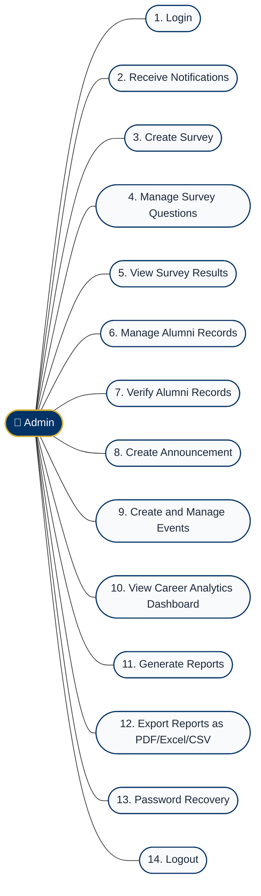

# CTU-Naga Alumni Connect — Administrator System Features Specification

> **Document Type:** System Requirements & Administrator Features Specification  
> **Source Artifact:** UML Use Case Diagram (Page 46 — Actor: Admin)  
> **Institution:** Cebu Technological University – Naga Campus (CTU-Naga)  
> **Target System:** Web-Based Alumni Tracking, Graduate Tracer Study, and Career Analytics System  
> **Regulatory Reference:** Republic Act No. 10173 (Data Privacy Act of 2012) & CHED CMO on Graduate Tracer Studies  

---

## 1. Overview & Scanned Use Case Diagram

The scanned document (**Page 46**) illustrates the UML Use Case Diagram for the **Admin** actor within the **CTU-Naga Alumni Connect** platform. The Administrator role acts as the central institutional authority (Alumni Relations Office / Placement & Career Services) responsible for alumni governance, tracer study execution, verification of graduate credentials, institutional announcements, event coordination, analytics, and compliance reporting.

### 1.1 Mermaid UML Use Case Representation

---

## 2. Executive Summary Matrix of Administrator Features

The 14 functional capabilities identified from the diagram are grouped into key functional subsystems:

| # | Use Case Name | Subsystem / Module | Primary Route / Component | Backend API Endpoint |
| :---: | :--- | :--- | :--- | :--- |
| **01** | **Login** | Identity & Access Control | `/auth/login` | `POST /api/auth/login` |
| **02** | **Receive Notifications** | System Alerts & Governance | `/admin/notifications`, Header Bell | `GET /api/notifications` |
| **03** | **Create Survey** | Graduate Tracer Study Engine | `/admin/surveys` | `POST /api/admin/surveys` |
| **04** | **Manage Survey Questions** | Dynamic Survey Orchestration | `/admin/surveys` | `POST /api/admin/surveys/:id/questions` |
| **05** | **View Survey Results** | Tracer Response Analytics | `/admin/surveys` | `GET /api/admin/surveys/:id/results` |
| **06** | **Manage Alumni Records** | Alumni Directory & Dossier | `/admin/alumni` | `GET/PUT/DELETE /api/admin/alumni` |
| **07** | **Verify Alumni Records** | Whitelist & Claim Validation | `/admin/alumni` | `POST /api/admin/eligible-alumni` |
| **08** | **Create Announcement** | Communication & Campus News | `/admin/announcements` | `POST /api/admin/announcements` |
| **09** | **Create and Manage Events** | Institutional Event Hub | `/admin/events` | `GET/POST/PUT/DELETE /api/admin/events` |
| **10** | **View Career Analytics Dashboard** | Career & Mobility Intelligence | `/admin/analytics`, `/admin` | `GET /api/admin/analytics` |
| **11** | **Generate Reports** | Compliance & Accreditation | `/admin/reports` | `GET /api/admin/reports` |
| **12** | **Export Reports as PDF/Excel/CSV** | Data Privacy & Export Pipeline | `/admin/reports`, `/admin/alumni` | Client + Server Exporters (`xlsx`, PDF) |
| **13** | **Password Recovery** | Account Security & Credential Reset | `/auth/forgot-password` | `POST /api/auth/forgot-password` |
| **14** | **Logout** | Session Governance | App Header / Navigation | Token revocation & store clearance |

---

## 3. Comprehensive Feature Specifications

### 3.1 Feature 1: Login
- **Use Case ID:** `UC-ADM-01`
- **Scanned Label:** `Login`
- **Objective:** Provide a secure, multi-layered gateway for university administrators to authenticate into the administrative management console.
- **Detailed Capabilities:**
  - Role-based credential authentication (`email` + `password`).
  - Strict role verification validating the account possesses `admin` privileges before routing to the `/admin` portal.
  - Multi-tiered rate limiting (Redis/in-memory rate limiters) to thwart brute force and credential-stuffing vectors.
  - Security event logging: successful logins and failed login attempts are stamped with IP address, user-agent, and timestamp.
  - JWT session token generation with secure HTTP cookies/bearer token authorization.
- **Key Codebase References:**
  - Client Page: [LoginPage.tsx](file:///client/src/pages/auth/LoginPage.tsx)
  - Server Route: [auth.ts](file:///server/src/routes/auth.ts)
  - Security Middleware: [rateLimiter.ts](file:///server/src/middleware/rateLimiter.ts)

---

### 3.2 Feature 2: Receive Notifications
- **Use Case ID:** `UC-ADM-02`
- **Scanned Label:** `Receive Notifications`
- **Objective:** Inform administrators in real time of critical institutional activities, pending actions, and security-relevant alerts.
- **Detailed Capabilities:**
  - Real-time unread notification badge indicator on the top navigation header bar.
  - Dedicated notification center (`/admin/notifications`) with tabbed categorization: *All*, *Unread*, *System*, *Alumni Verifications*, *Security Incidents*.
  - Event triggers generating admin notifications:
    - New alumni registrations requiring verification or whitelist reconciliation.
    - Graduate Tracer Survey milestone completion (e.g., reaching 75% cohort submission).
    - Unresolved security alerts (e.g., rapid consecutive failed logins or suspicious profile edits).
    - Partner employer job posting submissions awaiting review.
  - Interactive "Mark as Read", "Mark All as Read", and direct navigation links to resolve pending items.
- **Key Codebase References:**
  - Client UI: [NotificationsPage.tsx](file:///client/src/pages/notifications/NotificationsPage.tsx), [Header.tsx](file:///client/src/components/layout/Header.tsx)
  - Server Route: `server/src/routes/notifications.ts`

---

### 3.3 Feature 3: Create Survey
- **Use Case ID:** `UC-ADM-03`
- **Scanned Label:** `Create Survey`
- **Objective:** Allow administrators to configure and launch structured Graduate Tracer Studies (GTS) and institutional feedback instruments aligned with CHED (Commission on Higher Education) standards.
- **Detailed Capabilities:**
  - Survey authoring interface with configuration for:
    - **Survey Title & Description:** Institutional purpose and guidelines.
    - **Survey Category:** Mandatory Onboarding Tracer, Annual Graduate Tracer Study, Alumni Satisfaction, Curriculum Relevance Audit.
    - **Target Cohort Filtering:** Filter target respondents by Graduation Year (e.g., 2020–2025), Academic Program (e.g., BSIT, BIT-CT, BEED, BSED), or Campus Branch.
    - **Lifecycle Status:** Draft, Active/Published, Closed/Archived.
    - **Deadline & Access Restrictions:** Set opening and closing schedules.
  - Automated feed integration: automatically generates a published survey banner on eligible alumni dashboards.
- **Key Codebase References:**
  - Client Component: [GraduateTracerSurveys.tsx](file:///client/src/pages/admin/GraduateTracerSurveys.tsx)
  - Server Route: [surveys.ts](file:///server/src/routes/admin/surveys.ts)
  - Survey Standards: [APPENDIX_C_SURVEY_QUESTIONNAIRE.md](file:///APPENDIX_C_SURVEY_QUESTIONNAIRE.md)

---

### 3.4 Feature 4: Manage Survey Questions
- **Use Case ID:** `UC-ADM-04`
- **Scanned Label:** `Manage Survey Questions`
- **Objective:** Provide a dynamic survey question builder allowing administrators to define, sequence, and customize question fields within any survey.
- **Detailed Capabilities:**
  - Support for multi-faceted question types:
    - **Multiple Choice (Single Selection / Radio)**
    - **Checkboxes (Multi-Selection)**
    - **Short Text & Long Narrative Text**
    - **Likert Scale / Rating Matrix** (e.g., 1–5 scale evaluating curriculum relevance to current job).
    - **Salary & Compensation Brackets**
    - **Employment Classification Dropdowns** (e.g., Employed Full-time, Self-Employed, Unemployed Seeking, Unemployed Not Seeking).
  - Conditional branching and section sequencing (Personal Info $\rightarrow$ Educational Background $\rightarrow$ Employment History $\rightarrow$ University Assessment).
  - Toggle mandatory vs. optional response constraints.
  - Real-time reordering, editing, and archiving of question items without corrupting historical response datasets.
- **Key Codebase References:**
  - Client Component: [GraduateTracerSurveys.tsx](file:///client/src/pages/admin/GraduateTracerSurveys.tsx)
  - Server Route: [surveys.ts](file:///server/src/routes/admin/surveys.ts)

---

### 3.5 Feature 5: View Survey Results
- **Use Case ID:** `UC-ADM-05`
- **Scanned Label:** `View Survey Results`
- **Objective:** Analyze collected graduate responses through intuitive visualizations, summary metrics, and disaggregated response tables.
- **Detailed Capabilities:**
  - Real-time response counter and cohort completion rate percentage.
  - Visual charts showing:
    - Employment status distribution (Employed, Self-Employed, Unemployed, Underemployed).
    - Time elapsed from graduation to first employment (e.g., < 1 month, 1–3 months, 3–6 months, > 1 year).
    - Degree-to-job relevance rating across colleges and majors.
    - Monthly gross income bracket breakdown.
  - Individual respondent drill-down: review an individual alumnus's submitted survey answers with privacy masking.
  - Tabular data viewer with multi-criteria column filtering (by Year, Program, and Industry).
- **Key Codebase References:**
  - Client Component: [GraduateTracerSurveys.tsx](file:///client/src/pages/admin/GraduateTracerSurveys.tsx)
  - Server Route: [surveys.ts](file:///server/src/routes/admin/surveys.ts)

---

### 3.6 Feature 6: Manage Alumni Records
- **Use Case ID:** `UC-ADM-06`
- **Scanned Label:** `Manage Alumni Records`
- **Objective:** Centralized administrative master repository of all registered alumni accounts and career dossiers.
- **Detailed Capabilities:**
  - Master Alumni Table displaying: Name, Student ID, Program, Graduation Year, Current Job Title, Employer Name, Employment Status, and Verification Status.
  - Full-text search and multi-facet filtering (filter by program, year, latin honors, employment status, accreditation tier).
  - Alumni Profile Inspector modal: review complete educational background, employment history timeline, skills inventory, and contact info.
  - Edit alumni credentials, correct typographical errors, and update graduate records.
  - Secure alumni account archival and account status toggle (Active, Pending Verification, Suspended, Archived).
- **Key Codebase References:**
  - Client Component: [AlumniManagement.tsx](file:///client/src/pages/admin/AlumniManagement.tsx)
  - Server Route: [alumni.ts](file:///server/src/routes/admin/alumni.ts)

---

### 3.7 Feature 7: Verify Alumni Records
- **Use Case ID:** `UC-ADM-07`
- **Scanned Label:** `Verify Alumni Records`
- **Objective:** Ensure institutional data integrity by verifying newly registered alumni against official CTU-Naga Registrar graduation lists.
- **Detailed Capabilities:**
  - **Eligible Graduate Whitelist Engine:**
    - Bulk import official registrar graduate master lists via CSV/Excel containing Student ID, Full Name, Degree Program, and Graduation Date.
    - Auto-reconciliation: when a graduate registers, system performs fuzzy and exact matches against the official eligible graduates whitelist.
  - **Manual Verification Queue:**
    - Review alumni accounts flagged for manual verification (e.g., discrepancy in student number or name changes due to marriage).
    - View submitted verification documents (e.g., photo of Alumni ID, Diploma, or Transcript of Records).
    - One-click "Approve & Grant Verified Status" or "Reject with Explanation" buttons.
  - Automated notification and badge assignment: verified alumni receive the official university checkmark badge and unlock full platform capabilities.
- **Key Codebase References:**
  - Client Component: [AlumniManagement.tsx](file:///client/src/pages/admin/AlumniManagement.tsx)
  - Server Route: [eligibleAlumni.ts](file:///server/src/routes/admin/eligibleAlumni.ts), [alumni.ts](file:///server/src/routes/admin/alumni.ts)

---

### 3.8 Feature 8: Create Announcement
- **Use Case ID:** `UC-ADM-08`
- **Scanned Label:** `Create Announcement`
- **Objective:** Broadcast university announcements, policy memos, career advisories, and alumni community updates across the institution.
- **Detailed Capabilities:**
  - Announcement composer with Title, Category tag (*Career Opportunities*, *University Memo*, *Accreditation Update*, *General News*), and formatted body text.
  - Image attachment and document upload capabilities.
  - Audience targeting: Broadcast to all alumni or target specific graduating batches/programs.
  - Priority and Pinning options: Pin critical announcements to the top of alumni home dashboards and feeds.
  - Edit, update, schedule, or delete existing announcements.
- **Key Codebase References:**
  - Client Component: [AnnouncementManagement.tsx](file:///client/src/pages/admin/AnnouncementManagement.tsx)
  - Server Route: [announcements.ts](file:///server/src/routes/admin/announcements.ts)

---

### 3.9 Feature 9: Create and Manage Events
- **Use Case ID:** `UC-ADM-09`
- **Scanned Label:** `Create and Manage Events`
- **Objective:** Organize, publish, and administer institutional alumni events, homecomings, webinars, and on-campus career fairs.
- **Detailed Capabilities:**
  - Event authoring tool:
    - Event Title, Description, Category (*Homecoming*, *Reunion*, *Career Fair*, *Webinar*, *Workshop*).
    - Date, Time, Venue/Location (or Virtual Meeting Link).
    - Maximum attendee capacity and registration RSVP deadline.
    - Banner image upload.
  - Attendee roster management:
    - View live list of alumni who registered / RSVP'd for the event.
    - Export attendee roster for physical event check-in and security badge printing.
  - Event lifecycle management: publish, reschedule, mark completed, or cancel with attendee notification dispatch.
- **Key Codebase References:**
  - Client Component: [AdminEvents.tsx](file:///client/src/pages/admin/AdminEvents.tsx)
  - Server Route: [events.ts](file:///server/src/routes/admin/events.ts)

---

### 3.10 Feature 10: View Career Analytics Dashboard
- **Use Case ID:** `UC-ADM-10`
- **Scanned Label:** `View Career Analytics Dashboard`
- **Objective:** High-level strategic institutional intelligence summarizing graduate mobility, labor market absorption, and curriculum relevance.
- **Detailed Capabilities:**
  - Real-time KPI Summary Cards:
    - Overall Graduate Employment Rate (Full-time, Part-time, Self-Employed).
    - Degree-to-Job Alignment Rate (% of alumni working in fields directly related to their major).
    - Average Time-to-First-Employment across batches.
    - Average Starting Salary and Current Salary Brackets.
  - Dynamic interactive analytical charts:
    - Top hiring industries and top employer companies.
    - Program-by-program employment comparison (e.g., BSIT vs. Industrial Technology vs. Education).
    - Geographic distribution map: Domestic (Region VII, NCR, etc.) vs. Overseas Filipino Workers (OFWs).
    - Skill gap analytics: High-demand technical and soft skills highlighted by alumni.
  - Filterable by Graduation Year / Batch and Academic College.
- **Key Codebase References:**
  - Client Components: [CareerAnalytics.tsx](file:///client/src/pages/admin/CareerAnalytics.tsx), [CurriculumInsights.tsx](file:///client/src/pages/admin/CurriculumInsights.tsx), [AdminDashboard.tsx](file:///client/src/pages/admin/AdminDashboard.tsx)
  - Server Route: [analytics.ts](file:///server/src/routes/admin/analytics.ts), [curriculum-insights.ts](file:///server/src/routes/admin/curriculum-insights.ts)

---

### 3.11 Feature 11: Generate Reports
- **Use Case ID:** `UC-ADM-11`
- **Scanned Label:** `Generate Reports`
- **Objective:** Generate formal accreditation, compliance, and institutional assessment reports tailored for CHED, AACCUP, and university executive leadership.
- **Detailed Capabilities:**
  - Pre-configured institutional report templates:
    - **CHED Graduate Tracer Study (GTS) Official Compliance Report**
    - **AACCUP Accreditation Summary Report (Level I–IV)**
    - **Annual Employment & Career Trajectory Report**
    - **Curriculum Relevance & Industry Competency Evaluation Report**
    - **Unemployed Alumni Demographic & Intervention Roster**
  - Custom reporting engine: select target batch years, departments, specific survey instruments, and KPI metrics.
  - Real-time preview with tabular summaries and analytical footnotes.
- **Key Codebase References:**
  - Client Component: [ReportsPage.tsx](file:///client/src/pages/admin/ReportsPage.tsx)
  - Server Route: [reports.ts](file:///server/src/routes/admin/reports.ts)

---

### 3.12 Feature 12: Export Reports as PDF/Excel/CSV
- **Use Case ID:** `UC-ADM-12`
- **Scanned Label:** `Export Reports as PDF/Excel/CSV`
- **Objective:** Export generated reports and raw datasets into standard office and document formats while adhering to the Philippine Data Privacy Act.
- **Detailed Capabilities:**
  - **Export Formats Supported:**
    - **Excel (.xlsx):** Multi-sheet workbooks with styled header rows, calculated sums/averages, and formatted KPI tables (via `xlsx`).
    - **CSV (.csv):** Raw, RFC-4180 compliant comma-separated values for statistical analysis in SPSS, R, or Python.
    - **PDF (.pdf):** Formatted print-ready executive reports featuring university letterhead, executive summaries, data tables, and chart snapshots.
  - **Data Privacy Act of 2012 (RA 10173) Governance:**
    - Watermarking with administrator ID, timestamp, and confidentiality classification banner.
    - Automated PII anonymization options: mask contact numbers and email addresses on public accreditation summaries.
    - Audit logging of all export events: records which admin exported what dataset, at what timestamp, and with how many records.
- **Key Codebase References:**
  - Client Component: [ReportsPage.tsx](file:///client/src/pages/admin/ReportsPage.tsx)
  - Server Route: [reports.ts](file:///server/src/routes/admin/reports.ts)

---

### 3.13 Feature 13: Password Recovery
- **Use Case ID:** `UC-ADM-13`
- **Scanned Label:** `Password Recovery`
- **Objective:** Provide a secure, self-service mechanism for administrators to regain access to their account in case of forgotten credentials.
- **Detailed Capabilities:**
  - Password recovery request screen requiring the verified administrator email address.
  - Security validation: prevents email enumeration by returning consistent user feedback regardless of whether the email exists.
  - Secure, short-lived reset token (cryptographically random, TTL typically 15–30 minutes) generated and sent to the administrator's email.
  - Reset password interface enforcing university password complexity:
    - Minimum 8–12 characters.
    - Inclusion of uppercase, lowercase, numeric digits, and special symbols.
    - Disallowance of previously used passwords.
  - Automatic session revocation of all existing active sessions upon successful credential reset.
- **Key Codebase References:**
  - Client Page: [ForgotPasswordPage.tsx](file:///client/src/pages/auth/ForgotPasswordPage.tsx)
  - Server Route: [auth.ts](file:///server/src/routes/auth.ts)

---

### 3.14 Feature 14: Logout
- **Use Case ID:** `UC-ADM-14`
- **Scanned Label:** `Logout`
- **Objective:** Terminate the administrative session securely, preventing unauthorized post-session physical or browser access.
- **Detailed Capabilities:**
  - Accessible via the profile dropdown menu in the header navigation.
  - Instant invalidation of the client-side authentication state (Zustand auth store, React Query caches, and local storage tokens).
  - Server-side session audit logging: records session termination timestamp.
  - Immediate redirection to the university public landing page / login screen.
  - Cache-control directives ensuring browser "Back" button cannot restore cached administrative screens.
- **Key Codebase References:**
  - Client Components: [Header.tsx](file:///client/src/components/layout/Header.tsx), [authStore.ts](file:///client/src/store/authStore.ts)
  - Client Routing: [App.tsx](file:///client/src/App.tsx)

---

## 4. Architectural Mapping Table: Diagram to Codebase

| Diagram Use Case | Client Route & Component | Server Controller / Route | Database Table / Model |
| :--- | :--- | :--- | :--- |
| **Login** | `/auth/login` `[LoginPage.tsx]` | `POST /api/auth/login` `server/src/routes/auth.ts` | `auth.users`, `public.users` |
| **Receive Notifications** | `/admin/notifications` `[NotificationsPage.tsx]` | `GET /api/notifications` `server/src/routes/notifications.ts` | `public.notifications` |
| **Create Survey** | `/admin/surveys` `[GraduateTracerSurveys.tsx]` | `POST /api/admin/surveys` `server/src/routes/admin/surveys.ts` | `public.surveys`, `public.tracer_surveys` |
| **Manage Survey Questions** | `/admin/surveys` `[GraduateTracerSurveys.tsx]` | `POST /api/admin/surveys/:id/questions` `server/src/routes/admin/surveys.ts` | `public.survey_questions` |
| **View Survey Results** | `/admin/surveys` `[GraduateTracerSurveys.tsx]` | `GET /api/admin/surveys/:id/results` `server/src/routes/admin/surveys.ts` | `public.survey_responses`, `public.survey_answers` |
| **Manage Alumni Records** | `/admin/alumni` `[AlumniManagement.tsx]` | `GET/PUT/DELETE /api/admin/alumni` `server/src/routes/admin/alumni.ts` | `public.profiles`, `public.alumni_details` |
| **Verify Alumni Records** | `/admin/alumni` `[AlumniManagement.tsx]` | `POST /api/admin/eligible-alumni` `server/src/routes/admin/eligibleAlumni.ts` | `public.eligible_alumni`, `public.profiles` |
| **Create Announcement** | `/admin/announcements` `[AnnouncementManagement.tsx]` | `POST /api/admin/announcements` `server/src/routes/admin/announcements.ts` | `public.announcements`, `public.feed_posts` |
| **Create and Manage Events** | `/admin/events` `[AdminEvents.tsx]` | `GET/POST/PUT/DELETE /api/admin/events` `server/src/routes/admin/events.ts` | `public.events`, `public.event_attendees` |
| **View Career Analytics Dashboard** | `/admin/analytics`, `/admin` `[CareerAnalytics.tsx]` | `GET /api/admin/analytics` `server/src/routes/admin/analytics.ts` | `public.employment_records`, `public.profiles` |
| **Generate Reports** | `/admin/reports` `[ReportsPage.tsx]` | `GET /api/admin/reports` `server/src/routes/admin/reports.ts` | View queries, aggregated analytics views |
| **Export Reports as PDF/Excel/CSV** | `/admin/reports` `[ReportsPage.tsx]` | Direct stream / XLSX serializer `server/src/routes/admin/reports.ts` | Audit logged exports, `public.audit_logs` |
| **Password Recovery** | `/auth/forgot-password` `[ForgotPasswordPage.tsx]` | `POST /api/auth/forgot-password` `server/src/routes/auth.ts` | `auth.users`, password reset tokens |
| **Logout** | Header / User Menu `[Header.tsx]` | Auth store invalidation `client/src/store/authStore.ts` | Client state reset, session logout |

---

## 5. Security & Regulatory Compliance

Every administrative use case in the diagram operates under two primary regulatory constraints:

1. **Republic Act No. 10173 (Philippine Data Privacy Act of 2012):**
   - **Principle of Proportionality & Purpose Limitation:** Alumni personal identifiable information (PII) is only accessible to authorized alumni administrators for accredited tracer and placement functions.
   - **Data Security:** Encrypted at rest (AES-256) and in transit (TLS 1.3).
   - **Audit Trails:** Administrative modifications, deletions, and data export events are logged immutably in `public.audit_logs`.

2. **Commission on Higher Education (CHED) Memorandum Orders:**
   - Graduate Tracer Study instrumentation adheres to standard CHED GTS indicators:
     - General Information (personal and demographic data)
     - Educational Background (honors, degrees, certifications)
     - Employment Profile (first job search duration, present employment, job alignment, gross salary)
     - University Assessment (relevance of curriculum, teaching efficacy, laboratory facilities)

